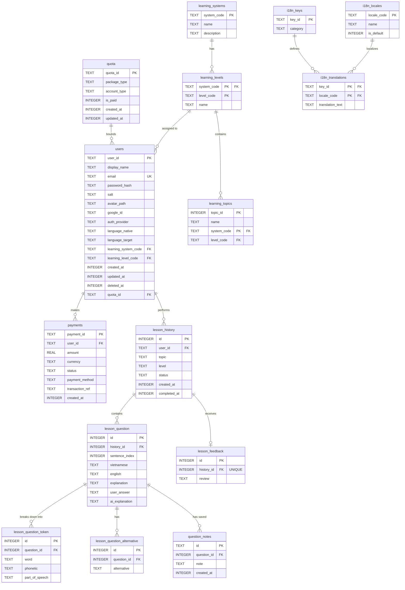

# Sơ đồ Database Schema - AI Lingua

Dưới đây là sơ đồ chi tiết các bảng cơ sở dữ liệu SQLite cục bộ (thông qua SQLDelight) được sử dụng trong hệ sinh thái ứng dụng học tập **AI Lingua**, trực quan hóa bằng Mermaid.

## Sơ đồ quan hệ thực thể (ERD)

---

## Chi tiết các bảng và Thuộc tính

### 1. Nhóm Người dùng & Phân quyền (Users & Quota)
* **`users`**: Lưu trữ hồ sơ tài khoản người dùng, cấu hình học tập hiện tại, ngôn ngữ mục tiêu (`language_target`), ngôn ngữ mẹ đẻ (`language_native`), và liên kết với phân quyền.
* **`quota`**: Định nghĩa các gói hạn ngạch sử dụng học tập (Day, Month, Year) theo phân hạng người dùng (VIP, Normal, Guest).
* **`payments`**: Lưu vết lịch sử giao dịch nạp VIP của học sinh.

### 2. Nhóm Lộ trình Học tập (Learning Roadmap)
* **`learning_systems`**: Danh sách lộ trình/chương trình học (ví dụ: CEFR, TOEIC, JLPT, HSK).
* **`learning_levels`**: Phân chia chi tiết cấp độ của từng lộ trình (ví dụ: A1/A2/B1/B2 với CEFR, N5->N1 với JLPT).
* **`learning_topics`**: Các chủ đề học tập thuộc các trình độ cụ thể.

### 3. Nhóm Đa ngôn ngữ (i18n Localization)
* **`i18n_locales`**: Quản lý mã quốc gia/ngôn ngữ (vi, en, ja).
* **`i18n_keys`**: Từ khóa dịch thuật tĩnh trong giao diện.
* **`i18n_translations`**: Bản dịch tương ứng cho từng key và từng locale.

### 4. Nhóm Tiến trình Bài học (Lesson History)
* **`lesson_history`**: Lưu thông tin tổng quan của mỗi lượt học (Chủ đề, trạng thái bài học hoàn thành hay đang tiến hành).
* **`lesson_feedback`**: Lưu trữ kết quả nhận xét tổng quan từ AI cho toàn bộ bài học.
* **`lesson_question`**: Chi tiết từng câu hỏi/câu luyện dịch trong bài học đó, kèm theo câu trả lời của học sinh và giải thích chi tiết từ AI.
* **`lesson_question_alternative`**: Bảng quan hệ 1-N lưu trữ độc lập từng phương án dịch thay thế chuẩn xác khác cho câu hỏi.
* **`lesson_question_token`**: Phân tích cú pháp của câu (tokenization) bao gồm từ vựng, phiên âm IPA (hoặc Pinyin/Romaji), và từ loại/giải nghĩa tương ứng.
* **`question_notes`**: Lưu trữ các công thức, cấu trúc ngữ pháp (sử dụng ID định dạng GUID) được người dùng lưu lại cho từng câu hỏi cụ thể, để tiện ôn tập.
