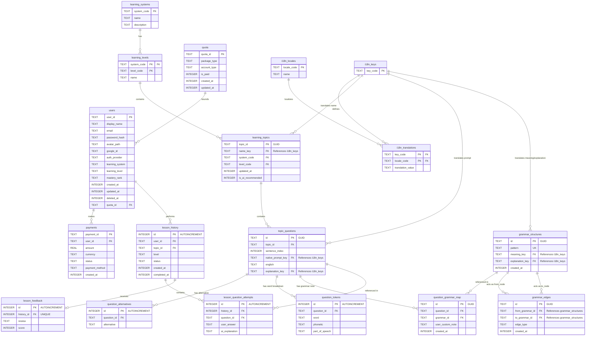

# Thiết kế Cơ sở Dữ liệu Cục bộ (Chuẩn hóa 3NF) - AI Lingua

Tài liệu này đặc tả thiết kế cơ sở dữ liệu cục bộ (SQLite) được chuẩn hóa theo dạng chuẩn 3 (3NF - Third Normal Form) nhằm tối ưu dung lượng đĩa, tránh dư thừa thông tin tĩnh, tăng hiệu năng truy vấn và sẵn sàng vận hành sản phẩm (Production-ready).

---

## 1. Điểm Cải tiến cốt lõi so với Phiên bản cũ

Trong phiên bản cũ, thông tin câu hỏi tĩnh (câu dịch gốc, đáp án đúng, phiên âm và giải nghĩa) được lưu lặp lại trực tiếp trong mỗi lượt làm bài của người dùng. Thiết kế 3NF mới đã giải quyết triệt để vấn đề này bằng cách tách thành hai tầng độc lập:
* **Tầng Dữ liệu Tĩnh (Static Database):** Chỉ lưu trữ 1 lần duy nhất danh sách câu hỏi của các chủ đề (`topic_questions`), các đáp án thay thế tĩnh (`question_alternatives`), phân tích cú pháp tĩnh (`question_tokens`), và từ điển ngữ pháp tĩnh (`grammar_structures`).
* **Tầng Tiến trình Động (Dynamic Attempt Database):** Chỉ lưu trữ lịch sử lượt học (`lesson_history`), câu trả lời thực tế của người dùng cùng đánh giá tương ứng từ AI (`lesson_question_attempts`), và nhận xét tổng quan (`lesson_feedback`).

---

## 2. Sơ đồ Quan hệ Thực thể (Mermaid ERD)



---

## 3. Chi tiết Bảng và Thuộc tính (Chuẩn hóa 3NF)

### 3.1 Nhóm Người dùng & Hạn mức (Users, Quota & Payments)
* **`users`**: Quản lý thông tin tài khoản người học. Cột `email` và `google_id` không cài đặt ràng buộc `UNIQUE` ở mức cột để hỗ trợ **Soft Delete** (xóa mềm), thay vào đó dùng chỉ mục có điều kiện.
* **`quota`**: Hạn ngạch sử dụng học tập (VIP, Free, Guest).
* **`payments`**: Lưu nhật ký các giao dịch thanh toán.

### 3.2 Nhóm Bản đồ Học tập & Đa ngôn ngữ (Roadmaps & Localization)
* **`learning_systems`**, **`learning_levels`**: Quản lý cấu trúc lộ trình và các trình độ tương ứng (ví dụ: TOEIC 300, JLPT N5).
* **`learning_topics`**: Lưu các chủ đề học tập. Tên chủ đề được dịch đa ngôn ngữ thông qua `name_key` liên kết sang bảng dịch thuật.
* **`i18n_locales`**, **`i18n_keys`**, **`i18n_translations`**: Lưu trữ mã ngôn ngữ, key dịch và bảng dịch thuật hỗ trợ đa ngôn ngữ động cho cả UI tĩnh và nội dung học trình tĩnh.

### 3.3 Nhóm Kho câu hỏi Tĩnh (Static Question Bank)
* **`topic_questions`**: Chứa thông tin tĩnh của câu hỏi.
  * `native_prompt_key`: Key dịch thuật của câu gợi ý dịch gốc (Ví dụ: "Gọi món ăn" trong tiếng Việt hoặc "注文する" trong tiếng Nhật).
  * `explanation_key`: Key giải thích từ vựng/cấu trúc chung của câu.
  * *Chỉ mục duy nhất:* `UNIQUE(topic_id, sentence_index)` đảm bảo cấu trúc vị trí câu hỏi không đổi.
* **`question_alternatives`**: Lưu trữ các đáp án thay thế hợp lệ cho một câu hỏi nhất định.
* **`question_tokens`**: Chứa phân tích chi tiết của từng từ (IPA, từ loại) trong câu hỏi.
* **`grammar_structures`**: Từ điển lưu các cấu trúc ngữ pháp dùng chung toàn hệ thống. Ý nghĩa và giải thích chi tiết được lưu dạng key dịch (`meaning_key`, `explanation_key`) để hỗ trợ học viên đa quốc gia.
* **`grammar_edges`**: Lưu vết các mối quan hệ cạnh đồ thị (đồ thị mạng tri thức) giữa các cấu trúc ngữ pháp (ví dụ: `PREREQUISITE` - tiên quyết, `SIMILAR` - tương đồng, `CONTRAST` - trái ngược, `DERIVED` - biến thể).
* **`question_grammar_map`**: Liên kết các câu hỏi tĩnh với cấu trúc ngữ pháp tương ứng, kèm theo ghi chú tùy biến riêng của học sinh (`user_custom_note`).

### 3.4 Nhóm Lịch sử Luyện tập Động (User Attempt Data)
* **`lesson_history`**: Đầu mục lịch sử luyện tập của người dùng, liên kết trực tiếp với mã chủ đề `topic_id`.
* **`lesson_question_attempts`**: Chỉ lưu câu trả lời thực tế của người dùng và nhận xét động từ AI cho câu trả lời đó. Hoàn toàn không lưu lại đề bài tĩnh.
* **`lesson_feedback`**: Lưu điểm số tổng hợp và nhận xét toàn bộ bài tập của AI cho attempt đó.

---

## 4. Chỉ mục & Tối ưu hóa hiệu năng (Indexes & Performance Optimizations)

Để đạt hiệu năng 60 FPS trên thiết bị di động/desktop, hệ cơ sở dữ liệu cấu hình các chỉ mục sau:

### 4.1 Chỉ mục Duy nhất có điều kiện (Soft Delete Uniqueness)
* **`idx_users_email_unique`**: `UNIQUE(email) WHERE deleted_at IS NULL` - Cho phép đăng ký lại bằng email cũ sau khi tài khoản đã bị xóa mềm.
* **`idx_users_google_id_unique`**: `UNIQUE(google_id) WHERE deleted_at IS NULL AND google_id IS NOT NULL`

### 4.2 Chỉ mục Khóa ngoại & Lọc tìm kiếm (Performance Indices)
* **`idx_users_deleted_at`**: `users(deleted_at)`
* **`idx_users_learning_system_level`**: `users(learning_system, learning_level)`
* **`idx_learning_topics_system_level`**: `learning_topics(system_code, level_code)`
* **`idx_topic_questions_topic_id`**: `topic_questions(topic_id)` - Tăng tốc truy vấn bộ câu hỏi của chủ đề.
* **`idx_question_alternatives_question_id`**: `question_alternatives(question_id)`
* **`idx_question_tokens_question_id`**: `question_tokens(question_id)`
* **`idx_question_grammar_map_question_id`**: `question_grammar_map(question_id)`
* **`idx_question_grammar_map_grammar_id`**: `question_grammar_map(grammar_id)` - Tăng tốc truy vấn chéo tìm các ví dụ mẫu chứa cấu trúc ngữ pháp.
* **`idx_grammar_edges_from`**: `grammar_edges(from_grammar_id)` - Tăng tốc duyệt đồ thị xuôi (tìm nút liên quan/nút con).
* **`idx_grammar_edges_to`**: `grammar_edges(to_grammar_id)` - Tăng tốc duyệt đồ thị ngược (tìm điều kiện tiên quyết).
* **`idx_lesson_history_user_id`**: `lesson_history(user_id)`
* **`idx_lesson_question_attempts_history_id`**: `lesson_question_attempts(history_id)` - Tăng tốc hiển thị màn hình Xem lại kết quả.
* **`idx_lesson_question_attempts_question_id`**: `lesson_question_attempts(question_id)`

---

## 5. Kiến trúc Đa ngôn ngữ Động (Dynamic Multilingual / i18n Integration)

Bằng cách loại bỏ hoàn toàn các trường văn bản cứng (hardcode) bằng một ngôn ngữ cụ thể ở các bảng tĩnh và thay thế bằng các liên kết khóa ngoại tới `i18n_keys`, hệ thống dễ dàng cấu hình và phân phối nội dung đa ngôn ngữ:

### 5.1 Luồng truy xuất bản dịch giao diện (Static UI localization)
Khi ứng dụng khởi tạo, toàn bộ nhãn tĩnh (UI Labels) thuộc ngôn ngữ mẹ đẻ của người dùng (`users.language_native`) được tải lên bộ nhớ đệm dạng `Map<String, String>` giúp truy xuất tức thời:
```sql
SELECT key_code, translation_value 
FROM i18n_translations 
WHERE locale_code = ?;
```

### 5.2 Truy vấn học trình bản địa hóa (Dynamic Curriculum Translation)
Khi người dùng duyệt danh sách chủ đề hoặc làm bài học, hệ thống thực hiện phép `JOIN` dựa trên ngôn ngữ mẹ đẻ của họ để kết xuất giao diện học trực quan:

```sql
-- Lấy câu gợi ý dịch tĩnh và giải thích tĩnh theo ngôn ngữ mẹ đẻ của học viên
SELECT 
    q.id AS question_id,
    q.sentence_index,
    q.english AS correct_answer,
    tp.translation_value AS localized_prompt, -- Đề bài dịch bản địa hóa
    te.translation_value AS localized_explanation -- Giải thích ngữ pháp bản địa hóa
FROM topic_questions q
INNER JOIN i18n_translations tp ON q.native_prompt_key = tp.key_code AND tp.locale_code = :user_native_language
LEFT JOIN i18n_translations te ON q.explanation_key = te.key_code AND te.locale_code = :user_native_language
WHERE q.topic_id = :topic_id
ORDER BY q.sentence_index ASC;
```

### 5.3 Kiến trúc Đồ thị Ngữ pháp (Grammar Knowledge Graph Integration)
Mô hình Graph được triển khai qua mối liên kết giữa `grammar_structures` (Nodes) và `grammar_edges` (Edges). Cấu trúc kề này cho phép hệ thống thực thi các thuật toán duyệt đồ thị ngữ pháp linh hoạt:

```sql
-- Tìm tất cả các cấu trúc ngữ pháp "tiên quyết" (Prerequisites) cần học trước
SELECT g_source.pattern, tm.translation_value AS localized_meaning
FROM grammar_edges e
INNER JOIN grammar_structures g_source ON e.from_grammar_id = g_source.id
INNER JOIN i18n_translations tm ON g_source.meaning_key = tm.key_code AND tm.locale_code = :user_native_language
WHERE e.to_grammar_id = :current_grammar_id AND e.edge_type = 'PREREQUISITE';
```
