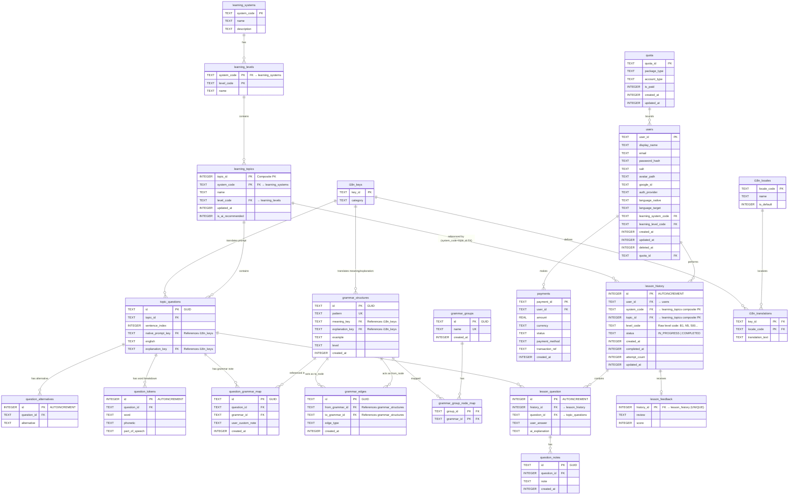

# Thiết kế Cơ sở Dữ liệu Cục bộ (Chuẩn hóa 3NF) - AI Lingua

Tài liệu này đặc tả thiết kế cơ sở dữ liệu cục bộ (SQLite) được chuẩn hóa theo dạng chuẩn 3 (3NF - Third Normal Form) nhằm tối ưu dung lượng đĩa, tránh dư thừa thông tin tĩnh, tăng hiệu năng truy vấn và sẵn sàng vận hành sản phẩm (Production-ready).

> **Phiên bản DB hiện tại:** `7`  
> **Lần cập nhật tài liệu cuối:** 2026-09-28

---

## 1. Lịch sử Migration

| Version | Migration file | Nội dung |
|---------|---------------|---------|
| 1 → 2 | `1.sqm` | Tạo bảng `question_notes` |
| 2 → 3 | `2.sqm` | Tạo các bảng grammar graph, feedback |
| 3 → 4 | `3.sqm` | Thêm `attempt_count`, `updated_at` vào `lesson_history` |
| 4 → 5 | `4.sqm` | Fix `attempt_count` default (0 thay vì 1) cho existing data |
| 5 → 6 | `5.sqm` | **3NF refactor**: xóa `topic TEXT` + `level TEXT` khỏi `lesson_history`, thêm `system_code`, `topic_id INTEGER NOT NULL`, `level_code`; custom topics được insert vào `learning_topics` |
| 6 → 7 | `6.sqm` | Loại bỏ các bảng grammar graph (`grammar_structures`, `grammar_edges`, `grammar_groups`, `grammar_group_node_map`, `question_grammar_map`) |

---

## 2. Điểm Cải tiến cốt lõi so với Phiên bản cũ

### 2.1 Tách Static vs Dynamic (từ đầu)

Trong phiên bản cũ, thông tin câu hỏi tĩnh (câu dịch gốc, đáp án đúng, phiên âm và giải nghĩa) được lưu lặp lại trực tiếp trong mỗi lượt làm bài của người dùng. Thiết kế 3NF mới đã giải quyết triệt để vấn đề này bằng cách tách thành hai tầng độc lập:

* **Tầng Dữ liệu Tĩnh (Static Database):** Chỉ lưu trữ 1 lần duy nhất danh sách câu hỏi của các chủ đề (`topic_questions`), các đáp án thay thế tĩnh (`question_alternatives`), phân tích cú pháp tĩnh (`question_tokens`), và từ điển ngữ pháp tĩnh (`grammar_structures`).
* **Tầng Tiến trình Động (Dynamic Attempt Database):** Chỉ lưu trữ lịch sử lượt học (`lesson_history`), câu trả lời thực tế của người dùng cùng đánh giá tương ứng từ AI (`lesson_question`), và nhận xét tổng quan (`lesson_feedback`).

### 2.2 3NF refactor `lesson_history` (Migration 5 → 6)

Vi phạm 3NF đã được xử lý trong `lesson_history`:

| Vấn đề trước | Giải pháp sau |
|---|---|
| `topic TEXT NOT NULL` — phụ thuộc bắc cầu: `id → topic_id → topic` | **Xóa** — tên topic lấy từ `JOIN learning_topics.name` |
| `level TEXT NOT NULL` — dư thừa với `learning_topics.level_code` | **Xóa** — tách thành `level_code TEXT` (mã thuần, không prefix) |
| `topic_id TEXT` nullable — FK không hợp lệ với composite PK `(system_code, topic_id INTEGER)` | **Đổi** thành `topic_id INTEGER NOT NULL` + `system_code TEXT NOT NULL` + FK đúng chuẩn |

**Custom topics** (người dùng tự nhập) trước đây chỉ tồn tại trong `lesson_history.topic`. Nay được insert vào `learning_topics` với `system_code = 'custom'` trước khi tạo lesson → đảm bảo toàn vẹn tham chiếu.

---

## 3. Sơ đồ Quan hệ Thực thể (Mermaid ERD)



---

## 4. Chi tiết Bảng và Thuộc tính (Chuẩn hóa 3NF)

### 4.1 Nhóm Người dùng & Hạn mức (Users, Quota & Payments)
* **`users`**: Quản lý thông tin tài khoản người học. Cột `email` và `google_id` không cài đặt ràng buộc `UNIQUE` ở mức cột để hỗ trợ **Soft Delete** (xóa mềm), thay vào đó dùng chỉ mục có điều kiện.
* **`quota`**: Hạn ngạch sử dụng học tập (VIP, Free, Guest).
* **`payments`**: Lưu nhật ký các giao dịch thanh toán.

### 4.2 Nhóm Bản đồ Học tập & Đa ngôn ngữ (Roadmaps & Localization)
* **`learning_systems`**: Các hệ thống học tập (CEFR, TOEIC, JLPT, HSK, ...) và hệ thống đặc biệt `'custom'` dành cho chủ đề người dùng tự nhập.
* **`learning_levels`**: Các cấp độ tương ứng với từng hệ thống (ví dụ: TOEIC/500, JLPT/N5). Bao gồm cấp độ `('custom', 'custom')` cho custom topics.
* **`learning_topics`**: Lưu các chủ đề học tập.
  * Predefined topics: `system_code ∈ {CEFR, TOEIC, JLPT, ...}`, được seed từ server.
  * **Custom topics**: `system_code = 'custom'`, `topic_id` = timestamp khi tạo (âm trong migration), được insert trước khi tạo lesson.
  * Edit topic name chỉ hỗ trợ cho custom topics (`system_code = 'custom'`).
* **`i18n_locales`**, **`i18n_keys`**, **`i18n_translations`**: Lưu trữ mã ngôn ngữ, key dịch và bảng dịch thuật hỗ trợ đa ngôn ngữ động.

### 4.3 Nhóm Kho câu hỏi Tĩnh (Static Question Bank)
* **`topic_questions`**: Chứa thông tin tĩnh của câu hỏi.
  * `native_prompt_key`: Key dịch thuật của câu gợi ý dịch gốc.
  * `explanation_key`: Key giải thích từ vựng/cấu trúc chung của câu.
* **`question_alternatives`**: Lưu trữ các đáp án thay thế hợp lệ cho một câu hỏi.
* **`question_tokens`**: Chứa phân tích chi tiết của từng từ (IPA, từ loại) trong câu hỏi.
* **`grammar_structures`**: Từ điển lưu các cấu trúc ngữ pháp dùng chung toàn hệ thống.
* **`grammar_groups`**: Các nhóm lọc/danh mục của đồ thị cấu trúc ngữ pháp.
* **`grammar_group_node_map`**: Bảng trung gian ánh xạ nhiều-nhiều giữa nhóm và cấu trúc ngữ pháp.
* **`grammar_edges`**: Các cạnh đồ thị tri thức ngữ pháp (`PREREQUISITE`, `SIMILAR`, `CONTRAST`, `DERIVED`).
* **`question_grammar_map`**: Liên kết câu hỏi tĩnh với cấu trúc ngữ pháp.
* **`question_notes`**: Ghi chú/bookmarks của học viên từ bài học AI Teacher.

### 4.4 Nhóm Lịch sử Luyện tập Động (User Attempt Data)

#### `lesson_history`

Đầu mục lịch sử luyện tập, được chuẩn hóa 3NF hoàn toàn từ version 6:

| Cột | Kiểu | Mô tả |
|-----|------|-------|
| `id` | `INTEGER PK` | ID auto |
| `user_id` | `TEXT FK → users` | Người học |
| `system_code` | `TEXT NOT NULL` | Hệ thống học: `'CEFR'`, `'TOEIC'`, `'JLPT'`, ..., `'custom'` |
| `topic_id` | `INTEGER NOT NULL` | FK vào `learning_topics(system_code, topic_id)` |
| `level_code` | `TEXT NOT NULL` | Mã cấp độ thuần, không có prefix: `'B1'`, `'500'`, `'N5'` |
| `status` | `TEXT` | `'IN_PROGRESS'` hoặc `'COMPLETED'` |
| `created_at` | `INTEGER` | Epoch ms — thời điểm tạo |
| `completed_at` | `INTEGER` | Epoch ms — thời điểm hoàn thành lần cuối |
| `attempt_count` | `INTEGER DEFAULT 0` | Số lần đã hoàn thành (tăng khi nhấn "Xem đánh giá") |
| `updated_at` | `INTEGER` | Epoch ms — thời điểm cập nhật mới nhất |

> **Lưu ý:** `level` dạng formatted string (ví dụ: `"TOEIC 500"`) được reconstruct trong tầng application bằng cách ghép `uiPrefix + level_code` — không lưu trong DB.

#### `lesson_question`
Chỉ lưu câu trả lời thực tế và đánh giá AI cho từng câu trong một bài. Không lưu lại đề bài tĩnh.

#### `lesson_feedback`
Lưu điểm số tổng hợp và nhận xét toàn bộ bài tập từ AI.

---

## 5. Chỉ mục & Tối ưu hóa hiệu năng (Indexes & Performance Optimizations)

### 5.1 Chỉ mục Duy nhất có điều kiện (Soft Delete Uniqueness)
* **`idx_users_email_unique`**: `UNIQUE(email) WHERE deleted_at IS NULL`
* **`idx_users_google_id_unique`**: `UNIQUE(google_id) WHERE deleted_at IS NULL AND google_id IS NOT NULL`

### 5.2 Chỉ mục Khóa ngoại & Lọc tìm kiếm (Performance Indices)
* **`idx_users_deleted_at`**: `users(deleted_at)`
* **`idx_learning_topics_system_level`**: `learning_topics(system_code, level_code)`
* **`idx_topic_questions_topic_id`**: `topic_questions(topic_id)`
* **`idx_question_alternatives_question_id`**: `question_alternatives(question_id)`
* **`idx_question_tokens_question_id`**: `question_tokens(question_id)`
* **`idx_question_grammar_map_question_id`**: `question_grammar_map(question_id)`
* **`idx_question_grammar_map_grammar_id`**: `question_grammar_map(grammar_id)`
* **`idx_grammar_edges_from`**: `grammar_edges(from_grammar_id)`
* **`idx_grammar_edges_to`**: `grammar_edges(to_grammar_id)`
* **`idx_lesson_history_user_id`**: `lesson_history(user_id)`
* **`idx_lesson_question_history_id`**: `lesson_question(history_id)`
* **`idx_lesson_question_question_id`**: `lesson_question(question_id)`

---

## 6. Kiến trúc Đa ngôn ngữ Động (Dynamic Multilingual / i18n Integration)

Bằng cách thay thế các trường text cứng bằng liên kết khóa ngoại tới `i18n_keys`, hệ thống phân phối nội dung đa ngôn ngữ:

### 6.1 Luồng truy xuất bản dịch giao diện (Static UI localization)

Khi ứng dụng khởi tạo, toàn bộ nhãn tĩnh theo ngôn ngữ mẹ đẻ (`users.language_native`) được tải vào cache:

```sql
SELECT key_id, translation_text 
FROM i18n_translations 
WHERE locale_code = ?;
```

### 6.2 Truy vấn học trình bản địa hóa (Dynamic Curriculum Translation)

```sql
-- Lấy câu gợi ý dịch tĩnh và giải thích theo ngôn ngữ mẹ đẻ của học viên
SELECT 
    q.id AS question_id,
    q.sentence_index,
    q.english AS correct_answer,
    COALESCE(tp.translation_text, q.native_prompt_key) AS localized_prompt,
    COALESCE(te.translation_text, q.explanation_key) AS localized_explanation
FROM topic_questions q
LEFT JOIN i18n_translations tp ON q.native_prompt_key = tp.key_id AND tp.locale_code = :user_native_language
LEFT JOIN i18n_translations te ON q.explanation_key = te.key_id AND te.locale_code = :user_native_language
WHERE q.topic_id = :topic_id
ORDER BY q.sentence_index ASC;
```

### 6.3 Truy vấn lịch sử luyện tập (3NF — JOIN lấy tên topic)

```sql
-- getAllHistoryWithCounts: JOIN với learning_topics để lấy tên topic
SELECT
    h.id,
    lt.name AS topic,          -- tên topic từ learning_topics (không còn denormalized)
    h.system_code,
    h.topic_id,
    h.level_code,              -- mã cấp độ thuần (B1, N5, 500...)
    h.status,
    h.created_at,
    h.completed_at,
    h.attempt_count,
    h.updated_at,
    COUNT(q.id)            AS total_count,
    COUNT(q.ai_explanation) AS completed_count
FROM lesson_history h
JOIN learning_topics lt ON h.system_code = lt.system_code AND h.topic_id = lt.topic_id
LEFT JOIN lesson_question q ON q.history_id = h.id
WHERE h.user_id = ?
GROUP BY h.id
ORDER BY h.created_at DESC;
```

### 6.4 Kiến trúc Đồ thị Ngữ pháp (Grammar Knowledge Graph Integration)

```sql
-- Tìm tất cả các cấu trúc ngữ pháp "tiên quyết" (Prerequisites) cần học trước
SELECT g_source.pattern, tm.translation_text AS localized_meaning
FROM grammar_edges e
INNER JOIN grammar_structures g_source ON e.from_grammar_id = g_source.id
INNER JOIN i18n_translations tm ON g_source.meaning_key = tm.key_id AND tm.locale_code = :user_native_language
WHERE e.to_grammar_id = :current_grammar_id AND e.edge_type = 'PREREQUISITE';
```

---

## 7. Convention Custom Topics

Custom topics (người dùng tự nhập chủ đề bài học) tuân theo convention sau:

| Thuộc tính | Giá trị |
|---|---|
| `learning_topics.system_code` | `'custom'` |
| `learning_topics.level_code` | `'custom'` |
| `learning_topics.is_ai_recommended` | `0` |
| `lesson_history.system_code` | `'custom'` |
| `lesson_history.topic_id` | Timestamp (ms) khi tạo — đảm bảo unique |
| `lesson_history.level_code` | Level code thực tế người dùng đang luyện (e.g. `'B1'`) |

**Lưu ý migration:** Trong migration 5→6, custom topics cũ (có `topic_id IS NULL`) được migrate với `topic_id = -id` (âm của `lesson_history.id`) để đảm bảo unique và không conflict với predefined topic IDs dương.

Chỉ custom topics mới có thể chỉnh sửa tên (nút ✏️ ẩn với predefined topics).
