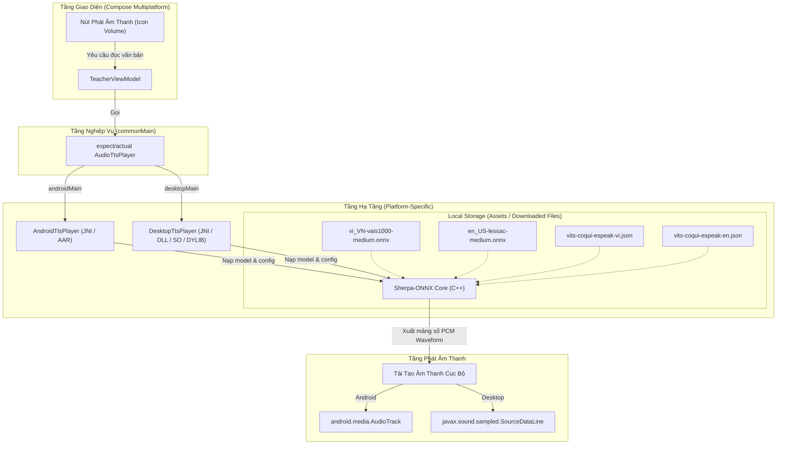

# 🎙️ Nghiên Cứu Giải Pháp Phát Audio (Text-to-Speech - TTS) Offline & Miễn Phí bằng ONNX trên Kotlin Multiplatform (KMP)

Tài liệu này nghiên cứu và đề xuất giải pháp phát âm thanh (TTS) **100% miễn phí (open-source)**, chạy **hoàn toàn offline (local-only)** cho cả tiếng Anh và tiếng Việt trên hai nền tảng chính của dự án: **Android** và **Desktop**.

---

## 🗺️ Bản Đồ Kiến Trúc Hệ Thống TTS Offline

Sơ đồ dưới đây mô tả cách thức hoạt động của hệ thống TTS chạy cục bộ không cần internet trên KMP:



---

## 1. Lựa Chọn Model ONNX TTS Tối Ưu (100% Free & Local)

Để chạy local ổn định và nhẹ nhàng, mô hình TTS phải có kích thước nhỏ gọn (dưới 50MB) nhưng vẫn đảm bảo độ tự nhiên và ngữ điệu giống người thật.

### 🌟 Đề xuất số 1: Piper TTS (VITS-based)
**Piper** là một hệ thống TTS cục bộ siêu nhanh, được tối ưu hóa cho các thiết bị cấu hình thấp. Piper thực chất là mô hình **VITS** được huấn luyện và tối ưu hóa chuyển đổi sang định dạng **ONNX** để chạy cực nhanh bằng ONNX Runtime.

*   **Giấy phép**: **MIT License** (Hoàn toàn miễn phí, cho phép thương mại hóa không ràng buộc).
*   **Dung lượng**: ~15MB (x_low) đến ~50MB (medium) cho mỗi giọng đọc. Rất thích hợp để đóng gói trực tiếp vào app hoặc tải về dưới dạng DLC (Downloadable Content).
*   **Các model đề xuất cho dự án**:
    *   **Tiếng Việt (vi_VN)**:
        *   `vi_VN-vais1000-medium.onnx` (Giọng miền Nam chuẩn, ấm áp, ngữ điệu tự nhiên).
        *   `vi_VN-vivos-x_low.onnx` (Cực kỳ nhẹ, tốc độ suy luận nhanh nhất, giọng miền Nam).
    *   **Tiếng Anh (en_US / en_GB)**:
        *   `en_US-lessac-medium.onnx` (Giọng đọc chuẩn Mỹ, phù hợp học thuật).
        *   `en_US-ljspeech-medium.onnx` (Giọng đọc chuẩn, chất âm trong trẻo).
        *   `en_GB-jenny_dioco-medium.onnx` (Giọng chuẩn Anh-Anh tự nhiên).
*   **Nguồn tải model chính thức**: [Hugging Face rhasspy/piper-voices](https://huggingface.co/rhasspy/piper-voices).

### 🌟 Đề xuất số 2: VITS Standard Models
Nếu muốn tùy biến giọng đọc chuyên sâu, chúng ta có thể sử dụng các mô hình VITS truyền thống được chuyển đổi sang ONNX.
*   **Giấy phép**: **MIT / Apache 2.0**.
*   **Tiếng Việt**: Cộng đồng phát triển các mô hình VITS tiếng Việt rất mạnh mẽ (ví dụ: [vits-tts-vietnamese](https://github.com/phatjkk/vits-tts-vietnamese)). Các model này được xuất ra file `.onnx` kèm file từ điển ngữ âm `.json`.

---

## 2. Giải Pháp Engine Suy Luận (Inference Engine) trên KMP

Để chạy file `.onnx` của Piper/VITS offline mà không cần cài đặt Python hay môi trường cồng kềnh, giải pháp tối ưu nhất là sử dụng **Sherpa-ONNX**.

### Tại sao chọn Sherpa-ONNX thay vì ONNX Runtime gốc?
1.  **Phonemization tích hợp sẵn**: Mô hình TTS không đọc trực tiếp chữ viết (Text) mà đọc các ký âm (Phonemes). Piper và VITS yêu cầu chuyển đổi văn bản thành phoneme (IPA) thông qua thư viện `espeak-ng`. `sherpa-onnx` đã tích hợp sẵn bộ chuyển đổi này bằng C++ chạy offline, chúng ta không cần viết code tiền xử lý ký âm bằng Kotlin phức tạp.
2.  **Hỗ trợ đa nền tảng**: Được thiết kế đặc biệt cho Speech processing, hỗ trợ sẵn Android, iOS, Windows, macOS, Linux, WebAssembly.
3.  **Tối ưu hóa hiệu năng**: Chạy trực tiếp qua JNI, tiêu thụ rất ít RAM và CPU, khởi động tức thì.
4.  **Giấy phép**: **Apache-2.0 License** (Miễn phí hoàn toàn).

---

## 3. Hướng Dẫn Tích Hợp Chi Tiết vào Kotlin Multiplatform (KMP)

### Bước 1: Thiết lập cấu trúc `expect`/`actual` ở tầng UI/Domain

Tại thư mục `shared/core/speech/` (hoặc module tương đương), định nghĩa interface giao tiếp chung:

```kotlin
// commonMain
package com.aienglish.core.speech

interface AudioTtsPlayer {
    /**
     * Nạp model cho ngôn ngữ tương ứng
     * @param languageCode "vi" hoặc "en"
     */
    suspend fun initialize(languageCode: String): Boolean

    /**
     * Phát âm thanh từ văn bản
     */
    suspend fun speak(text: String)

    /**
     * Dừng phát âm thanh ngay lập tức
     */
    fun stop()

    /**
     * Giải phóng tài nguyên engine
     */
    fun release()
}
```

---

### Bước 2: Triển khai trên Android (`androidMain`)

Sử dụng thư viện Java/Kotlin wrapper của `sherpa-onnx` dành cho Android.

1.  **Thêm dependency trong `shared/build.gradle.kts`**:
    ```kotlin
    androidMain.dependencies {
        implementation("com.k2fsa.sherpa.onnx:sherpa-onnx:1.10.3") // Hoặc version mới nhất
    }
    ```
2.  **Triển khai `actual class AndroidTtsPlayer`**:
    ```kotlin
    // androidMain
    package com.aienglish.core.speech

    import android.content.Context
    import android.media.AudioAttributes
    import android.media.AudioFormat
    import android.media.AudioManager
    import android.media.AudioTrack
    import com.k2fsa.sherpa.onnx.OfflineTts
    import com.k2fsa.sherpa.onnx.OfflineTtsConfig
    import kotlinx.coroutines.Dispatchers
    import kotlinx.coroutines.withContext
    import java.io.File

    class AndroidTtsPlayer(private val context: Context) : AudioTtsPlayer {
        private var ttsEngine: OfflineTts? = null
        private var audioTrack: AudioTrack? = null

        override suspend fun initialize(languageCode: String): Boolean = withContext(Dispatchers.IO) {
            try {
                // Giả định các file model .onnx và .json config được lưu ở Asset hoặc cacheDir
                val modelPath = getModelFile(languageCode) // vi_VN-vais1000-medium.onnx
                val lexiconPath = getLexiconFile(languageCode) // vits-coqui-espeak-vi.json
                
                val config = OfflineTtsConfig().apply {
                    model.vits.model = modelPath
                    model.vits.lexicon = lexiconPath
                    model.vits.tokens = getTokensFile(languageCode)
                    model.numThreads = 2
                }
                
                ttsEngine = OfflineTts(context.assets, config)
                true
            } catch (e: Exception) {
                e.printStackTrace()
                false
            }
        }

        override suspend fun speak(text: String) = withContext(Dispatchers.Default) {
            val engine = ttsEngine ?: return@withContext
            val audio = engine.generate(text) // Sinh ra mảng float chứa dữ liệu âm thanh PCM
            
            val sampleRate = audio.sampleRate
            val samples = audio.samples // floatArrayOf(...)
            
            // Convert FloatArray PCM sang ShortArray để phát qua AudioTrack
            val shortSamples = ShortArray(samples.size) { i ->
                (samples[i] * 32767.0f).coerceIn(-32768f, 32767f).toInt().toShort()
            }

            stop() // Dừng audio cũ nếu đang phát

            audioTrack = AudioTrack.Builder()
                .setAudioAttributes(
                    AudioAttributes.Builder()
                        .setUsage(AudioAttributes.USAGE_MEDIA)
                        .setContentType(AudioAttributes.CONTENT_TYPE_SPEECH)
                        .build()
                )
                .setAudioFormat(
                    AudioFormat.Builder()
                        .setEncoding(AudioFormat.ENCODING_PCM_16BIT)
                        .setSampleRate(sampleRate)
                        .setChannelMask(AudioFormat.CHANNEL_OUT_MONO)
                        .build()
                )
                .setBufferSizeInBytes(shortSamples.size * 2)
                .setTransferMode(AudioTrack.MODE_STATIC)
                .build().apply {
                    write(shortSamples, 0, shortSamples.size)
                    play()
                }
        }

        override fun stop() {
            audioTrack?.apply {
                if (playState == AudioTrack.PLAYSTATE_PLAYING) {
                    stop()
                }
                release()
            }
            audioTrack = null
        }

        override fun release() {
            stop()
            ttsEngine = null
        }
        
        // Helper methods để đọc file từ Assets hoặc Download storage...
        private fun getModelFile(lang: String): String = ...
        private fun getLexiconFile(lang: String): String = ...
        private fun getTokensFile(lang: String): String = ...
    }
    ```

---

### Bước 3: Triển khai trên Desktop (`desktopMain`)

Trên Desktop JVM, ta sử dụng JNI bằng cách nạp native library `.dll` (Windows), `.so` (Linux), hoặc `.dylib` (macOS).

1.  **Tải/Bundle Native Libs**:
    *   Tải thư viện `sherpa-onnx-jni` tương ứng với OS mục tiêu từ trang releases của [sherpa-onnx](https://github.com/k2-fsa/sherpa-onnx/releases).
    *   Đặt các file native này trong thư mục `resources/` của desktop app để app tự giải nén và nạp bằng `System.load()` khi chạy.
2.  **Triển khai `actual class DesktopTtsPlayer`**:
    ```kotlin
    // desktopMain
    package com.aienglish.core.speech

    import com.k2fsa.sherpa.onnx.OfflineTts
    import com.k2fsa.sherpa.onnx.OfflineTtsConfig
    import kotlinx.coroutines.Dispatchers
    import kotlinx.coroutines.withContext
    import javax.sound.sampled.AudioFormat
    import javax.sound.sampled.AudioSystem
    import javax.sound.sampled.SourceDataLine

    class DesktopTtsPlayer : AudioTtsPlayer {
        private var ttsEngine: OfflineTts? = null
        private var line: SourceDataLine? = null

        companion object {
            init {
                // Tự động load native libraries tương thích với OS
                NativeLibLoader.loadSherpaOnnx()
            }
        }

        override suspend fun initialize(languageCode: String): Boolean = withContext(Dispatchers.IO) {
            try {
                val config = OfflineTtsConfig().apply {
                    model.vits.model = "path/to/${languageCode}_model.onnx"
                    model.vits.lexicon = "path/to/${languageCode}_lexicon.txt"
                    model.vits.tokens = "path/to/${languageCode}_tokens.txt"
                    model.numThreads = 2
                }
                ttsEngine = OfflineTts(config)
                true
            } catch (e: Exception) {
                e.printStackTrace()
                false
            }
        }

        override suspend fun speak(text: String) = withContext(Dispatchers.Default) {
            val engine = ttsEngine ?: return@withContext
            val audio = engine.generate(text)
            
            val sampleRate = audio.sampleRate.toFloat()
            val samples = audio.samples
            
            // Convert sang byte array PCM 16bit Little Endian
            val byteBuffer = ByteArray(samples.size * 2)
            for (i in samples.indices) {
                val sampleValue = (samples[i] * 32767.0f).coerceIn(-32768f, 32767f).toInt()
                byteBuffer[i * 2] = (sampleValue and 0xFF).toByte()
                byteBuffer[i * 2 + 1] = ((sampleValue shr 8) and 0xFF).toByte()
            }

            stop()

            val format = AudioFormat(sampleRate, 16, 1, true, false)
            line = AudioSystem.getSourceDataLine(format).apply {
                open(format)
                start()
                write(byteBuffer, 0, byteBuffer.size)
                drain()
                close()
            }
        }

        override fun stop() {
            line?.apply {
                stop()
                flush()
                close()
            }
            line = null
        }

        override fun release() {
            stop()
            ttsEngine = null
        }
    }
    ```

---

## 4. Kế Hoạch Lưu Trữ & Triển Khai Models (Data Strategy)

Vì file mô hình `.onnx` có dung lượng từ **15MB - 50MB**, chúng ta có 2 phương án lưu trữ để chạy offline:

| Phương Án | Mô tả | Ưu Điểm | Nhược Điểm |
| :--- | :--- | :--- | :--- |
| **Phương án A: Bundle sẵn (Asset)** | Đóng gói trực tiếp file `.onnx` và config vào assets của app. | Cài app xong là dùng được ngay, không cần mạng ở lần đầu tiên. | Làm tăng dung lượng file cài đặt (APK/Desktop installer) thêm khoảng 60MB - 100MB. |
| **Phương án B: Tải động (DLC)** | Người dùng chọn ngôn ngữ nào thì tải gói ngôn ngữ đó ở lần đầu tiên (lưu vào cacheDir). | File cài đặt app cực nhẹ (~10MB), cài đặt nhanh. | Yêu cầu kết nối mạng duy nhất một lần đầu khi tải gói ngôn ngữ. |

👉 **Khuyến nghị cho dự án**:
*   Sử dụng **Phương án B (Tải động)** để giữ dung lượng ứng dụng ban đầu nhỏ gọn.
*   Khi người dùng bắt đầu một bài học (ví dụ: Gia sư Tiếng Anh), ứng dụng sẽ tự động tải file `en_US-lessac-medium.onnx` về máy nếu chưa tồn tại cục bộ, lưu vào thư mục lưu trữ nội bộ và nạp vào `Sherpa-ONNX` để phát audio offline mãi mãi.

---

## 5. Tổng Kết Đánh Giá Giải Pháp

1.  **Chi phí**: **0đ (Hoàn toàn miễn phí)**. Không giới hạn ký tự đọc, không lo phát sinh chi phí API.
2.  **Khả năng hoạt động**: **100% Offline**. Rất phù hợp với định hướng *offline-first* của dự án.
3.  **Tốc độ**: Cực kỳ nhanh. Độ trễ (latency) khi tạo âm thanh gần như bằng 0, đáp ứng tốt cho giao tiếp thời gian thực (Real-time TTS).
4.  **Bảo mật**: An toàn tuyệt đối, dữ liệu giọng nói của người dùng hoặc bài học không bao giờ bị gửi lên đám mây.
